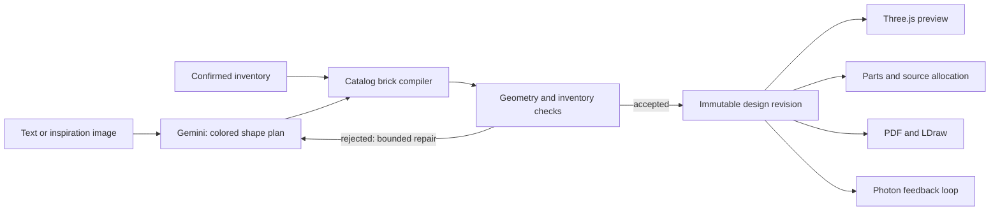

# Large Lego Model

Turn an idea and existing LEGO bricks into a detailed three-dimensional build, exact parts list, and illustrated instructions. **Large Lego Model** is the architecture name. **Sprout** is a provisional product name.

HackNC 2026 · React / TypeScript / Three.js / Node · Gemini · Photon Spectrum

## Run the review checkpoint

Requires Node.js 22 or newer and npm. Clone this repository, then:

```sh
npm ci
cp -n .env.example .env
npm run dev
```

Open [http://127.0.0.1:5173](http://127.0.0.1:5173). The API runs on port 3001. The website updates during frontend edits, and the API restarts automatically after server/shared-code changes. Credentials are re-read from `.env` when used.

The six curated sample builds work without API keys. Start with the [1,345-piece courtyard castle](http://127.0.0.1:5173/?design=sample-castle): hollow towers, a central keep, furnished rooms, window openings, and five sloped roofs. Samples are labeled and are never substituted for an AI response. Rotate the model, open **Build steps** and **Pieces**, add owned bricks, use **Download 3D (.usdz)** directly below the model, or open **Let's build** for the matching PDF, CSV, LDraw model, USDZ, and preview. Assembly steps contain at most 12 new pieces with per-piece navigation, exact part/color quantities, a top-down placement map, replay, and saved viewing progress.

There is no application piece-count ceiling or default small-piece budget. Explicit API budgets and owned-only stock still apply. Review this checkpoint with `npm test` and the castle's 127-step guide; additional pieces alone do not establish good design. Manual exports show progress and render in a worker so the API stays responsive. With the local server running, `npm run check:large-export` checks that behavior without making an AI call.

## Connect the real services

| Service | Local environment variables | Setup |
| --- | --- | --- |
| Gemini | `GEMINI_API_KEY`, optional `GEMINI_MODEL` | [Google AI Studio](https://aistudio.google.com/apikey) |
| Rebrickable | `REBRICKABLE_API_KEY` | [API key instructions](https://rebrickable.com/api/) |
| Photon Spectrum | `SPECTRUM_PROJECT_ID`, `SPECTRUM_PROJECT_SECRET` | [Photon dashboard](https://app.photon.codes/dashboard), HackNC promo `HACKWITHPHOTON` |
| Phone viewer links | `PUBLIC_BASE_URL` | Your deployed HTTPS origin; localhost does not work on someone else's phone |

Keys belong only in `.env`, which Git ignores. Never use a `VITE_` prefix for these secrets. The app's Connections panel reports configured fields, not a successful live service test.

After configuring Photon and Gemini, run `npm run photon` in a separate terminal. This starts a real agent that replies to incoming messages. See [Photon setup and track requirements](docs/photon-setup.md). The app's **Copy command to continue in iMessage** action freezes the current design and inventory and gives you an `/open` command for that worker.

Large iMessage models use lossless binary USDZ packaging when OpenUSD's `usdcat` and `usdzip` are available on `PATH`. Without them, the original export remains available; files exceeding Photon's 100 MiB request limit must be downloaded from the web app. This transport limit does not limit the number of pieces in a build.

## Architecture



Gemini describes occupied colored space, curved cross-section profiles, local cutouts for interiors and openings, directional slope runs, exact spanning parts, and repeated feature groups. Its planning instructions prioritize actual openings, interiors, floors, roofs, and connected sections. The compiler chooses real catalog pieces, interlocks neighboring layers where possible, and enforces exact stock in owned-only mode. The compiler can use flat plate courses and bounded local repacking to resolve unsupported seams without changing occupied colored cells. Only a fully valid arrangement is accepted. No overlap, unsupported elevated piece, or disconnected final assembly passes the geometry gate. Concrete real-world subjects, including animals and plants, are looked up on Wikimedia using canonical article titles to avoid namesakes; actual reference images enter planning. Geometry-valid models are rendered from two angles and compared to the photographs. Quick aims for a checked draft in about 2.5 minutes after a worker starts, excluding queue wait. Detailed allows more research and refinement. The website keeps refining until Stop; Photon Quick ends with its best checked draft or a clear next choice within its shared time budget. A usable or visually matched result is not guaranteed. The UI shows progress, source credits and concrete likeness issues. A reviewed draft can be returned as “Needs refinement”; this is not a passed likeness check. Failures preserve the current design.

All outputs derive from the same placements. Exported/shared snapshots receive new IDs and cannot overwrite earlier revisions. Source allocations retain exact part/color and the set instance or loose-brick lot. An inventory photo produces suggestions that the user must confirm.

## Current boundaries

- 36 real part IDs: bricks, plates, tiles, two upright slopes, round 1×1 pieces and a small cone; 13 colors with verified part/color combinations and four yaw orientations. Coordinates use studs horizontally and plate heights vertically. The physical workspace is 96 × 96 studs × 384 plate heights; there is no piece-count ceiling. Request size, provider output, and execution-time limits still apply. The heuristic compiler may reject feasible geometry or inventory instead of finding an optimal packing.
- Geometric support and connectivity are checked. Clutch strength, torque, tipping, material wear, and intermediate physical stability are **not simulated**. A real hand-build remains part of demo validation.
- More curves, wedges, and verified moving/connector families remain required catalog expansions. Current parts stay upright on the stud grid; nonrectangular collision envelopes are conservative. Rebrickable catalog records verify allowed part/color combinations, not current stock or price. Minifigures, arbitrary mesh conversion, and collaborative assembly remain unimplemented.
- Rebrickable imports the endpoint's available set inventory. It excludes spares/unsupported parts and does not automatically resolve alternate historical inventory versions. Verify counts against the physical set.
- Live Gemini generation produced a 520-piece observatory in 36 seconds after one repair, with 52 steps and a matching 55-page PDF. Two preceding detailed requests failed brick checks; this is not a reliability benchmark. After narrow-plate and packing fixes, fresh Bell Tower requests passed in 24.02 seconds (436 pieces) and 21.65 seconds through the website (346 pieces). Their likeness to the actual tower is still inadequate. Reference-photo planning and comparison now produced a fresh 5,910-piece Taj Mahal and two rose drafts that pass geometry but remain marked as needing refinement. Other complex attempts still fail; the new open curved petal grammar has not yet produced an accepted live rose. See the checkpoint 06 record for the actual results. Inspection found real rooms, windows, supports and slopes, but missed plate eaves and incomplete terrace access. The 1,345-piece castle remains a curated sample. Rebrickable authentication, part colors and a real set lookup passed. Reliable photo-backed generation, Photon delivery and target-iPhone behavior still need successful live checks.
- The API binds to localhost by default. Before public hosting, add user authentication, quotas, durable shared storage, and deployment-specific origin controls. This checkpoint is a local/team prototype.

## Team workflow

- `main`: clean research baseline.
- `feat/brick-studio`: current review implementation. Make your own branch from it for contributions; do not force-push a teammate's work.
- [Stage checklists](docs/STAGES.md) define what is ready to review and what remains.
- [Accepted objective](docs/OBJECTIVE.md) preserves scope, including native 3D feedback in iMessage and later ElevenLabs voice.
- [Verification record](docs/VERIFICATION.md) records checks and service boundaries.

```sh
npm test
npm run build
npm start
```

`npm start` serves the built frontend and API at [http://127.0.0.1:3001](http://127.0.0.1:3001). Local runtime state is stored under ignored `data/`. Generated review artifacts are under ignored `output/`.

## Research and attribution

- [Generation options and the BrickGPT decision](docs/generation-research.md)
- [Observed LEGO Builder screens and assembly UX](docs/lego-builder-ux.md)
- [Complex models and catalog expansion](docs/complex-builds.md)
- [First plate and slope increment](docs/part-catalog-increment.md)
- [Parts, geometry, inventory provenance, and instructions](docs/parts-research.md)
- [Native 3D viewing and messages](docs/imessage-3d-preview.md)
- [HackNC / Photon setup and sources](docs/photon-setup.md)

The code implements a new restricted compiler; it does not include or run BrickGPT model weights. Rendered brick exteriors are procedural geometry with catalog dimensions, rather than redistributed LDraw library assets. LDraw exports reference official part filenames. Rebrickable catalogs and images are not bundled. LEGO is a trademark of the LEGO Group; this is an independent hackathon project.
