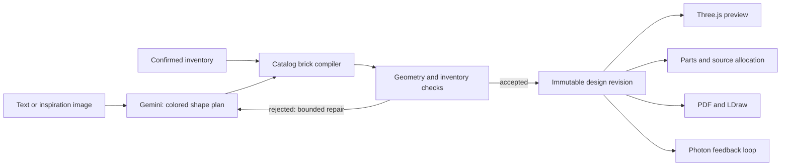

# Large Lego Model

Turn an idea and existing LEGO bricks into a small brick sculpture, exact parts list, and illustrated instructions. **Large Lego Model** is the architecture name. **Sprout** is a provisional product name.

HackNC 2026 · React / TypeScript / Three.js / Node · Gemini · Photon Spectrum

## Run the review checkpoint

Requires Node.js 22 or newer and npm. Clone this repository, then:

```sh
npm ci
cp -n .env.example .env
npm run dev
```

Open [http://127.0.0.1:5173](http://127.0.0.1:5173). The API runs on port 3001. The website updates automatically during frontend edits; restart `npm run dev` after server/shared-code changes. Credentials are re-read from `.env` when used.

The four curated sample builds work without API keys. They are labeled samples; they are never substituted for an AI response. Start with a sample, rotate it, open **Build steps** and **Pieces**, add some owned bricks, then use **Let's build** to download the matching PDF, CSV, LDraw model, and preview.

## Connect the real services

| Service | Local environment variables | Setup |
| --- | --- | --- |
| Gemini | `GEMINI_API_KEY`, optional `GEMINI_MODEL` | [Google AI Studio](https://aistudio.google.com/apikey) |
| Rebrickable | `REBRICKABLE_API_KEY` | [API key instructions](https://rebrickable.com/api/) |
| Photon Spectrum | `SPECTRUM_PROJECT_ID`, `SPECTRUM_PROJECT_SECRET` | [Photon dashboard](https://app.photon.codes/dashboard), HackNC promo `HACKWITHPHOTON` |
| Phone viewer links | `PUBLIC_BASE_URL` | Your deployed HTTPS origin; localhost does not work on someone else's phone |

Keys belong only in `.env`, which Git ignores. Never use a `VITE_` prefix for these secrets. The app's Connections panel reports configured fields, not a successful live service test.

After configuring Photon and Gemini, run `npm run photon` in a separate terminal. This starts a real agent that replies to incoming messages. See [Photon setup and track requirements](docs/photon-setup.md). The app's **Copy command to continue in iMessage** action freezes the current design and inventory and gives you an `/open` command for that worker.

## Architecture



Gemini describes occupied colored space. The compiler chooses real catalog brick placements, interlocks neighboring layers where possible, and enforces exact stock in owned-only mode. No overlap, floating brick, or disconnected final assembly passes the geometry gate. Rejected generations receive up to two repair attempts; persistent failure preserves the user's current design.

All outputs derive from the same placements. Exported/shared snapshots receive new IDs and cannot overwrite earlier revisions. Source allocations retain exact part/color and the set instance or loose-brick lot. An inventory photo produces suggestions that the user must confirm.

## Current boundaries

- Seven ordinary upright rectangular brick sizes, nine colors, quarter-turn rotation, a 24 × 24 × 24 grid, and at most 160 bricks. The compiler is a heuristic and may reject a feasible inventory rather than find an optimal packing.
- Geometric support and connectivity are checked. Clutch strength, torque, tipping, material wear, and intermediate physical stability are **not simulated**. A real hand-build remains part of demo validation.
- Plates, hinges, minifigures, specialty geometry, moving mechanisms, arbitrary mesh conversion, and collaborative assembly are future work.
- Rebrickable imports the endpoint's available set inventory. It excludes spares/unsupported parts and does not automatically resolve alternate historical inventory versions. Verify counts against the physical set.
- API-free samples and local exports are tested. Live Gemini generation, authenticated Rebrickable lookup, Photon delivery, and iPhone behavior require credentials/device verification; no live success is claimed yet.
- The API binds to localhost by default. Before public hosting, add user authentication, quotas, durable shared storage, and deployment-specific origin controls. This checkpoint is a local/team prototype.

## Team workflow

- `main`: clean research baseline.
- `feat/brick-studio`: current review implementation. Make your own branch from it for contributions; do not force-push a teammate's work.
- [Stage checklists](docs/STAGES.md) define what is ready to review and what remains.
- [Accepted objective](docs/OBJECTIVE.md) preserves scope, including native 3D feedback in iMessage and later ElevenLabs voice.
- [Verification record](docs/VERIFICATION.md) records checks and service boundaries.

```sh
npm test
npm run build
npm start
```

`npm start` serves the built frontend and API at [http://127.0.0.1:3001](http://127.0.0.1:3001). Local runtime state is stored under ignored `data/`. Generated review artifacts are under ignored `output/`.

## Research and attribution

- [Generation options and the BrickGPT decision](docs/generation-research.md)
- [Parts, geometry, inventory provenance, and instructions](docs/parts-research.md)
- [Native 3D viewing and messages](docs/imessage-3d-preview.md)
- [HackNC / Photon setup and sources](docs/photon-setup.md)

The code implements a new restricted compiler; it does not include or run BrickGPT model weights. Rendered brick exteriors are procedural geometry with catalog dimensions, rather than redistributed LDraw library assets. LDraw exports reference official part filenames. Rebrickable catalogs and images are not bundled. LEGO is a trademark of the LEGO Group; this is an independent hackathon project.
