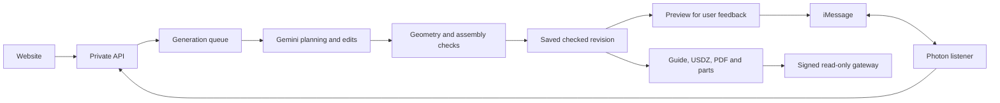

# How the project fits together

Large LEGO Model uses one saved brick model across the studio, iMessage previews, parts lists and instructions. Gemini proposes geometry and edits. Local code checks whether the supported pieces can connect and be placed in sequence.

## Processes

| Process | Entry point | Role |
| --- | --- | --- |
| Website | [src/App.tsx](../src/App.tsx) | Local studio, inventory, generation progress and exports; Vite uses port 5173 during development |
| Private API | [server/index.ts](../server/index.ts) | Generation jobs, saved designs and exports on loopback port 3001 by default |
| Photon listener | [server/photon.ts](../server/photon.ts) | Receives iMessages, persists conversations and calls the existing API |
| Public guide gateway | [server/instruction-share.ts](../server/instruction-share.ts) | Started by the API on loopback port 3002; exposes only signed read-only guide content |

The iMessage conversation requires approval before final delivery. The website remains a local editing and export surface. Don't expose its private API or Vite through the public tunnel.

## Request to checked revision

[photon-routing.ts](../server/photon-routing.ts) recognizes commands and clear conversational actions. [photon-chat.ts](../server/photon-chat.ts) handles bounded Gemini interpretation when needed. [photon-conversation.ts](../server/photon-conversation.ts) owns selected drafts, feedback, approval and delivery receipts.

[generation-jobs.ts](../server/generation-jobs.ts) persists jobs and runs [generation-worker.ts](../server/generation-worker.ts). The website and Photon share this queue. [generation.ts](../server/generation.ts) coordinates reference analysis, planning, compilation, checking and repair within the job's execution limits.

[references.ts](../server/references.ts), [reference-research.ts](../server/reference-research.ts) and [reference-model.ts](../server/reference-model.ts) gather reference material. [catalog-resolver.ts](../server/catalog-resolver.ts) loads verified part snapshots and resolves supported additions. A catalog record doesn't automatically make a connection usable.

[compiler.ts](../server/compiler.ts) turns plans into exact placements. [model.ts](../shared/model.ts) defines the shared model, part accounting and validation. [assembly.ts](../shared/assembly.ts) finds checked insertion sequences. Repairs retain those checks; a connected shape can still fail placement ordering.

Revisions begin with the selected saved placements and request targeted patches. Failed edits keep the prior checked build. The demo skips post-build visual scoring, but [likeness.ts](../server/likeness.ts) and [likeness-review.ts](../server/likeness-review.ts) retain the optional reviewer. User approval remains separate from every automated check.

## Approval and exports

A complete checked preview waits for feedback. Approval captures its revision ID; final delivery and retries use that same revision. A later edit creates a new draft and requires another approval. Stop invalidates pending conversation work, though an already submitted transport message can't be recalled.

[BuildGuide.tsx](../src/BuildGuide.tsx) provides ordinary 3D assembly, with optional AR. [manual.ts](../server/manual.ts) queues PDF work; [manual-render.ts](../server/manual-render.ts) draws the pages. [manual-repeats.ts](../shared/manual-repeats.ts) identifies exact repeat groups while preserving placement order.

[native-export.ts](../server/native-export.ts) prepares exact and phone-viewing files using [native-model.ts](../server/native-model.ts) and [mobile-model.ts](../server/mobile-model.ts). [usdz-package.ts](../server/usdz-package.ts) retains imported-part attribution and optionally compacts the package with OpenUSD tools. Phone rendering may merge geometry or omit covered surface detail; the saved placements and parts accounting remain canonical.

## Storage and boundaries

| Location | Contents |
| --- | --- |
| `data/designs/` | Saved revisions and associated inventory snapshots |
| `data/generation-jobs/` | Requests, progress, attempts and job results |
| `data/photon-sessions/` | Conversation state, selected/approved revisions and delivery receipts |
| `data/catalog/` | Downloaded sources and resolved part/color records |
| `data/manual-cache/` | Prepared PDFs |
| `data/instruction-share-key` | Secret used to sign revision links |
| Browser local storage | Studio collection and guide progress on that device |

These runtime files and `.env` stay out of Git. Run the processes from the repository root so they use the same local data. Keep saved designs and the signing key persistent if previously sent guide links need to keep working.

A signed guide link grants access to one revision and its allowed downloads. The public response omits prompts, photos, research and unrelated inventory. Anyone holding the link can forward it. See [security](../SECURITY.md) before hosting.

## Useful checks

Run `npm test` and `npm run build` before submitting a meaningful change. Use the [live test guide](live-testing.md) for provider and phone behavior. Rendering or manual changes also need visual inspection. Existing tests, a passed geometry check and a phone opening a file each establish different things.
